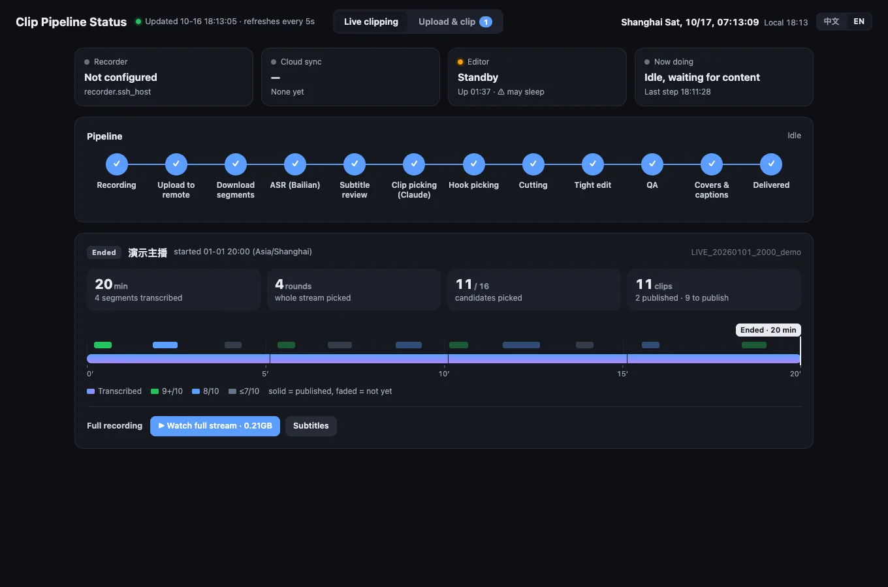
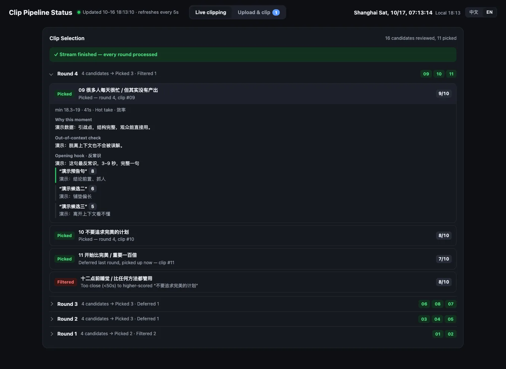
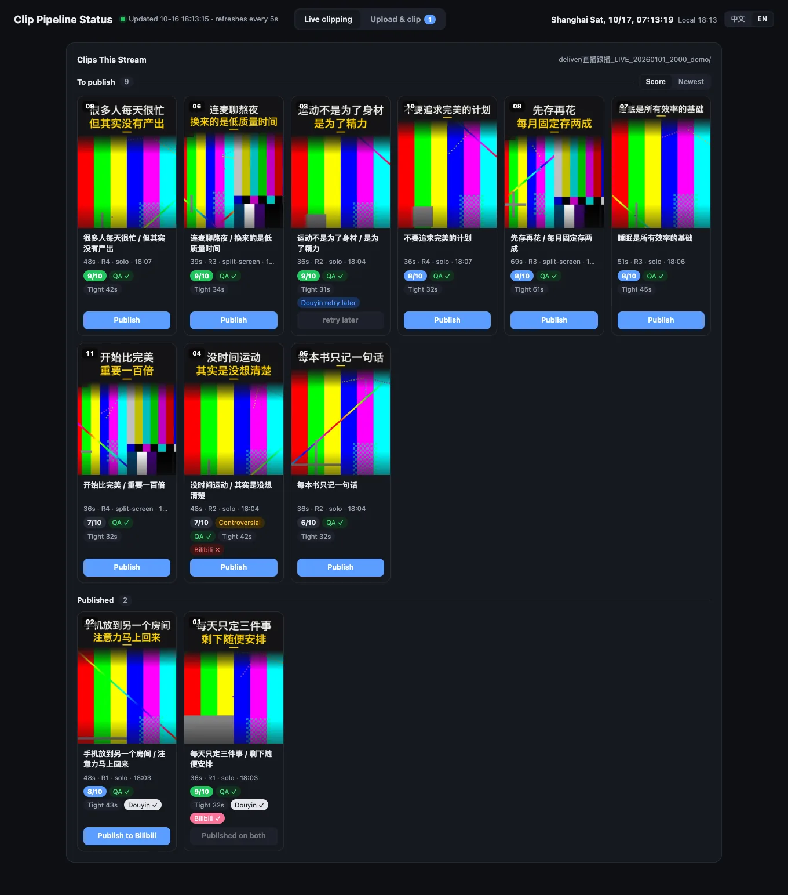
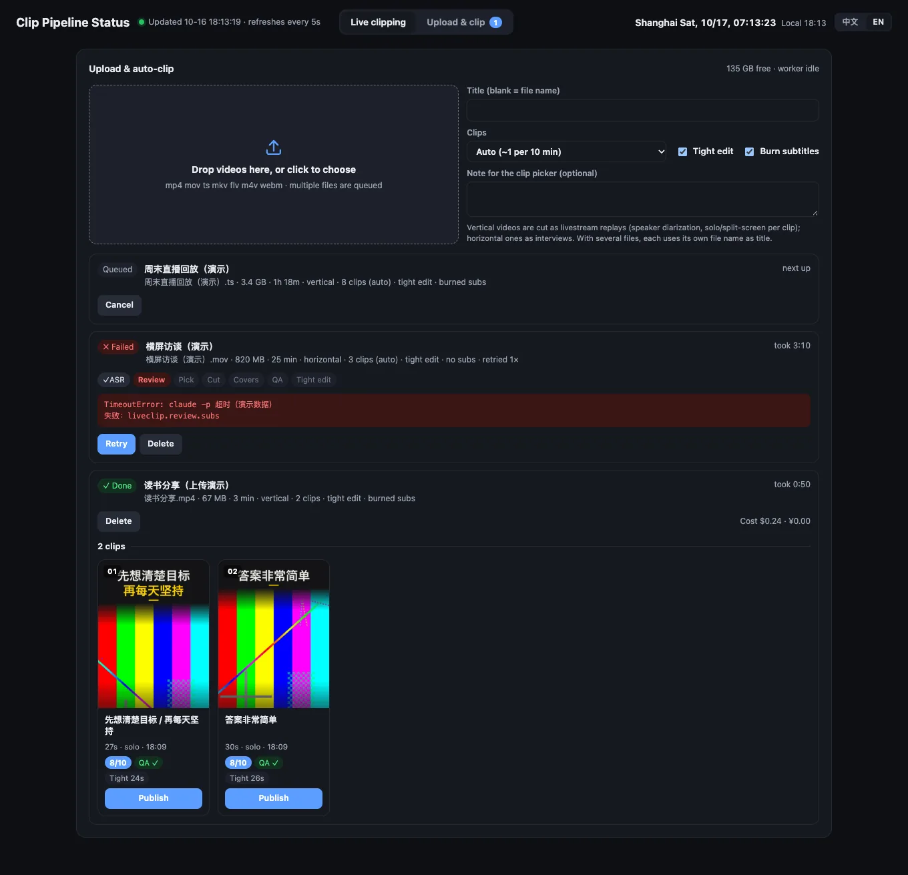
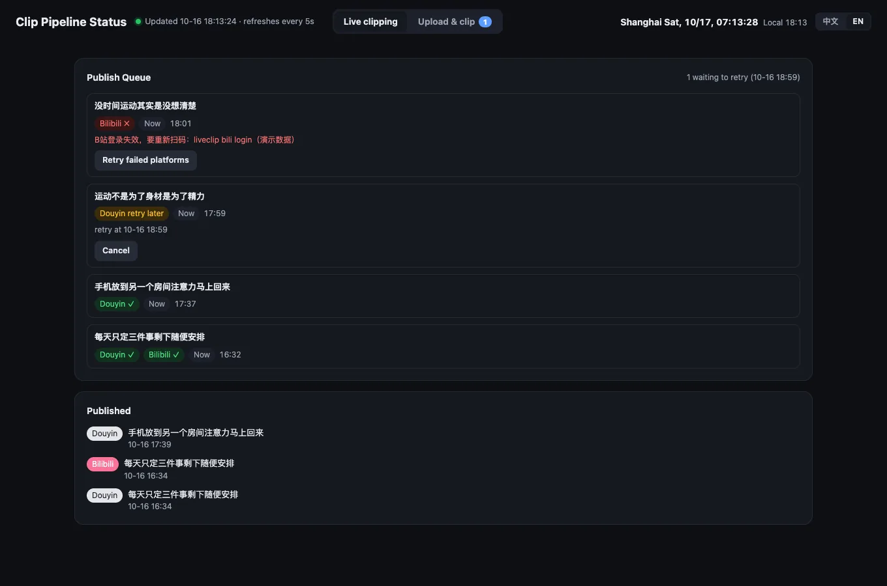
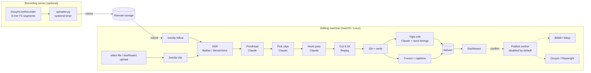

# LiveClip

**Live-follow auto clipping for Chinese streamers.** LiveClip turns livestreams and long talking-head videos into
vertical short clips — while the stream is still running:

record → transcribe → proofread → LLM clip picking → hook (teaser) → cut → tight edit → QA → covers & captions →
dashboard → optional publishing

[中文说明 → README.zh-CN.md](README.zh-CN.md)

> Status: 0.1.0, extracted from a pipeline that clipped a real creator's daily livestreams in production.
> Prompts and on-screen text are Chinese; the code is platform-agnostic Python + ffmpeg.

> All screenshots use synthetic demo data (test patterns + canned model answers, see `tests/sample.py`); no real footage.

| Overview: pipeline + session timeline | Picking decisions (picked / deferred / filtered, with reasons and hook candidates) |
|---|---|
|  |  |
| Clip wall (covers, scores, QA, tight edit, publish state) | Upload & auto-clip |
|  |  |
| Publish queue | Output: single person full frame / split-screen co-stream / 3:4 cover |
|  |  |

## What it does

- **Live follow.** A small server records the room in 5-minute segments and uploads them (rclone). `liveclip follow`
  transcribes each segment as it arrives and every 20 minutes of transcript asks Claude to pick clips, re-picks the
  opening hook, cuts, tight-edits, QA-checks and packages them. When the stream ends you get the full version with SRT.
- **One-shot.** `liveclip clip video.mp4` does the same for any file (or drag files onto the dashboard).
- **Clip picking that respects the speaker**: standalone segments with a claim, a reason and a payoff; short / medium /
  long tiers; context check against quoting out of context; risk flag; title rules; topics per platform.
- **Editing details that matter on short-video platforms**: hook teaser up front, blur-fill 9:16 with per-clip layout
  (single person vs. split-screen co-stream, detected automatically), burned subtitles with sane line breaks, end
  card, loudness normalisation, platform-friendly encoding, audio timestamp repair (see [docs/lessons.md](docs/lessons.md)).
- **Tight edit**: removes fillers, stutters, false starts and guest back-channel using word-level ASR timestamps,
  with safeguards (never deletes a negation unless it is repeated).
- **QA**: face cut off, title over face, mid-sentence cuts, A/V sync (audio *and* video offsets), AAC packet spacing,
  full decode.
- **Covers** in 3:4, 4:3 and 16:9 from a clean frame with open eyes; **captions** (title + topics) for Douyin,
  Xiaohongshu, Bilibili and WeChat Channels.
- **Dashboard** (127.0.0.1): pipeline status, per-round picking decisions with reasons, clip wall with player and QA,
  uploads, publish queue, cost ledger.
- **Optional publishing** (off by default): Bilibili via biliup, Douyin via Playwright on a dedicated Chrome profile,
  with account verification, pacing and a publish log as the source of truth.
- **Montage**: the same catch-phrase across several sessions, cut on silence boundaries.

## Architecture



Every step is a module you can run on its own (`liveclip pick …`, `liveclip cut …`); the orchestrators call them as
subprocesses, and every intermediate result (transcripts, plans, QA reports) is a JSON file you can inspect or edit.

## Requirements

- Python ≥ 3.11, macOS or Linux (Windows is not supported: file locking and process groups are POSIX).
- **ffmpeg / ffprobe** on PATH.
- **Claude**: either [Claude Code](https://docs.claude.com/en/docs/claude-code) installed and logged in (`claude -p`
  is used; on a subscription costs are not billed per call), or `ANTHROPIC_API_KEY` + `pip install 'liveclip[api]'`.
- **ASR**: an Alibaba Cloud Bailian / DashScope API key (`DASHSCOPE_API_KEY`) for the recommended engine, or local
  SenseVoice (`pip install 'liveclip[asr-local]'`, heavier: PyTorch). You can also bring your own transcript
  (`--asr-json`, format below).
- **A Chinese font**: found automatically on macOS (Hiragino / PingFang) and Linux (Noto Sans CJK). For the intended
  look, put [Noto Sans SC](https://fonts.google.com/noto/specimen/Noto+Sans+SC) (SIL OFL, variable TTF) into
  `<workspace>/assets/fonts/`.
- Optional: **rclone** (live follow, archive); a recording server with
  [DouyinLiveRecorder](https://github.com/ihmily/DouyinLiveRecorder) (MIT); face detection — macOS Vision is compiled
  on first use with `swiftc` (Xcode command line tools), or `pip install 'liveclip[vision]'` (OpenCV) on Linux;
  `liveclip[montage]` (jieba); `liveclip[publish]` (Playwright, biliup).

## Install

```bash
git clone <this repo> liveclip && cd liveclip
uv venv && uv pip install -e '.[api]'        # or: python -m venv .venv && .venv/bin/pip install -e '.[api]'
mkdir ~/liveclip-ws && cd ~/liveclip-ws
liveclip init                                 # config.yaml, .env, data/ clips/ deliver/ videos/ …
$EDITOR config.yaml .env                      # persona, tags; keys
liveclip doctor
```

## Quickstart: clip one video

```bash
liveclip clip ~/Videos/talk.mp4 --title "某期直播" --top 6 --live --auto-layout --tight --tight-separate
open deliver/候选_talk_*/专辑.html            # preview page: every clip with cover, title, reasons
```

Output per clip: `deliver/候选_<id>_<date>/NN_<title>/` with `视频.mp4` (normal cut), `视频_精剪.mp4` (tight cut),
`封面.jpg` (3:4), `封面_横4比3.jpg` (4:3), `封面_B站.jpg` (16:9), `文案.txt` (titles + topics per platform), plus
`候选清单.txt`, `质检.json`, `验收.json` and a log for the run. Options: `--live` (livestream mode: burn subtitles,
diarize), `--auto-layout` (detect single vs. split screen per clip), `--layout talk_h|full_h|live_v|duet_v|full_v`,
`--subs file.srt` (human subtitles), `--asr-json` (skip ASR), `--note "…"` (extra instructions for the picker).

**Try it without any API key** — a synthetic 3-minute video, canned LLM answers, nothing billed:

```bash
python tests/sample.py /tmp/lc-demo && cd /tmp/lc-demo
LIVECLIP_LLM_FIXTURES=fixtures liveclip clip videos/demo.mp4 --asr-json data/asr/demo_bailian.json \
    --title 演示 --top 2 --live --auto-layout --tight --tight-separate
```

Transcript format (`--asr-json`, also what `liveclip asr` writes):
`{"body": [{"from": 12.3, "to": 15.1, "content": "一句话", "spk": "主播"}]}` (`spk` optional).

## Live follow

1. Set up the recording server and remote: [deploy/README.md](deploy/README.md).
2. In config.yaml: `live.remote`, `live.anchors`, optionally `live.archive_remote` and `recorder.ssh_host`.
3. `liveclip follow --keep-awake` (keep it running; it catches up after sleep or restarts).

Each session gets an ID `LIVE_<date>_<time>_<key>`; clips land in `deliver/直播跟播_<ID>/` round by round, the full
version with SRT in `完整版/` after the stream. Type today's event or guest into the dashboard and the next round
prefers related segments.

## Dashboard

```bash
liveclip dashboard            # http://127.0.0.1:8771  (?lang=en for English labels)
```
Pipeline status, current step, per-round decisions (picked / deferred / overlapping / filtered, with the model's
reasons and hook candidates), clip wall with player (normal / tight), QA findings, drag-and-drop uploads, publish
queue, costs. It binds to localhost only and shows raw logs — don't expose it.

## Publishing (disabled by default)

LiveClip can upload to Bilibili (biliup) and Douyin (Playwright, dedicated Chrome profile). **It is off unless you
set `publish.enabled: true` and the platform's `enabled: true`.** Douyin additionally requires `publish.douyin.account_id`;
the uploader reads the logged-in account and refuses to post to any other. Items are only queued when you click
"confirm" on the dashboard; the publish log is the source of truth; captchas / SMS / QR prompts always stop the run.

> **Only publish content you own or are explicitly authorised to use. Automated uploading may violate a platform's
> terms of service; you use these modules at your own risk and are responsible for complying with platform rules and
> copyright law.** The maintainers provide no warranty (see LICENSE).

```bash
pip install 'liveclip[publish]'      # Douyin drives your installed Google Chrome (no browser download)
liveclip bili login && liveclip bili deliver/…/01_x            # dry run prints the command; add --go to upload
liveclip douyin login && liveclip douyin upload deliver/…/01_x --dry-run
```

## Costs

Order-of-magnitude, measured on real streams (your mileage will vary):
- **ASR (Bailian file transcription)**: roughly 60k tokens per hour of audio — well under ¥1 per hour at list prices.
- **Claude**: proofreading ≈ $0.07 per ~150 subtitle lines with lean calls; picking, hook and tight edit are one call
  per window/clip. A one-hour stream is typically a few dollars at API prices. With the Claude Code CLI on a
  subscription the ledger shows API-price *equivalents*, not charges.
- Everything paid is recorded in `data/cost_log.jsonl` (`liveclip cost`, dashboard "costs"). Transcripts, review
  chunks and picks are cached, so re-runs are mostly free.

## Limitations

- Prompts, captions and folder names are Chinese and tuned for Chinese talk/livestream content.
- Nothing replaces a human pass: every clip should be watched before publishing (titles, context, subtitles, framing).
- Layout detection targets vertical Douyin-style live rooms (single person or left/right split screen); other layouts
  need `--layout` / plan overrides.
- Speaker diarization is sentence-level; quick back-and-forth can be attributed to the wrong person.
- Douyin's web UI changes; the Playwright selectors may need maintenance. Bilibili scheduled posts must be ≥ 4 h ahead.
- macOS Vision gives the best face/eye detection; the OpenCV fallback is coarser, and without either, covers use the
  middle frame and QA skips face checks.

## Project layout

```
liveclip/            package (one module per step, see `liveclip --help`)
  dashboard/         local web dashboard
  publish/           optional uploaders + performance stats
  worker/            background workers (uploads, publish queue)
deploy/              recording-server uploader, systemd units, recorder notes
docs/                lessons.md (why the code is the way it is), MIGRATION.md
tests/               unit tests + offline end-to-end run on a synthetic sample
```

## License

MIT — see [LICENSE](LICENSE). Third-party tools are used as external dependencies under their own licenses
(DouyinLiveRecorder: MIT, biliup: MIT, Playwright: Apache-2.0, FunASR: MIT — its models have their own licenses, Noto Sans SC: SIL OFL 1.1).
