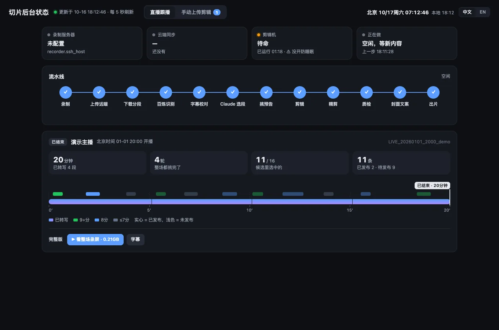
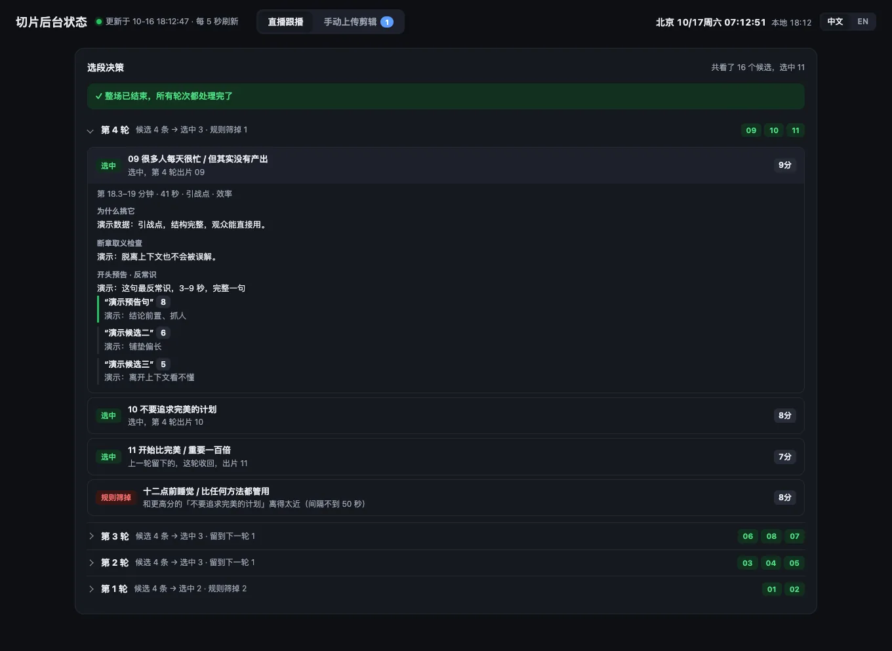
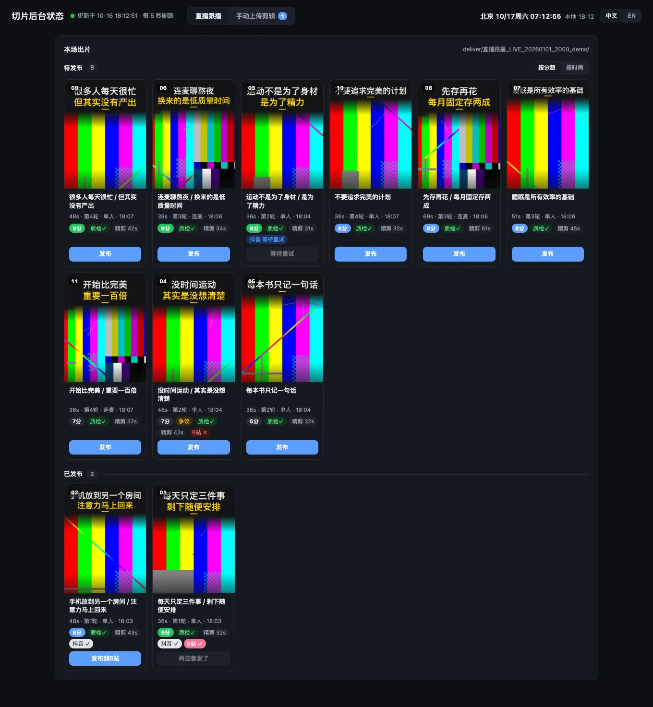
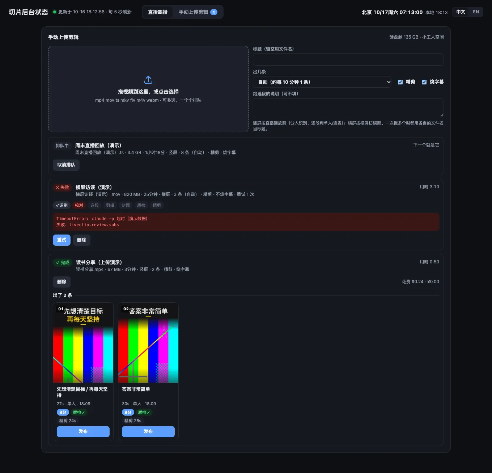
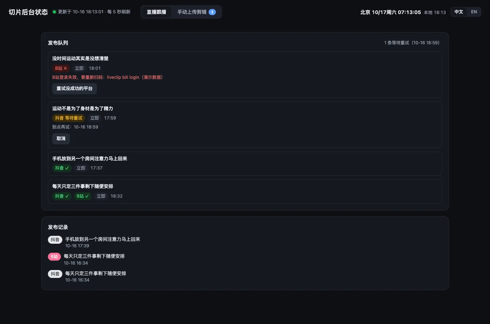
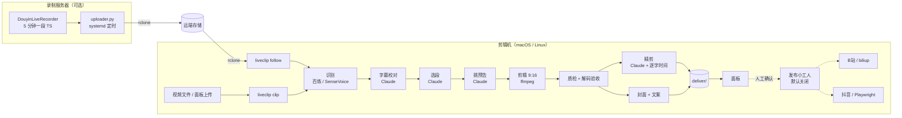

# LiveClip

**给中文主播的「跟播」自动切片工具。** 直播还没结束，切片就已经在出了：

录制 → 语音识别 → 字幕校对 → 大模型选段 → 开头预告 → 剪辑 → 精剪 → 质检 → 封面和文案 → 面板 → （可选）发布

[English → README.md](README.md)

> 状态：0.1.0。从一套每天给真实博主做直播切片的生产流程里整理出来。提示词和画面文字是中文；代码是 Python + ffmpeg。

> 截图全部来自合成演示数据（测试图案 + 预置的模型回答，见 `tests/sample.py`），不含任何真人素材。

| 总览：流水线 + 本场时间轴 | 选段决策（每轮选中 / 留到下一轮 / 规则筛掉 + 理由、预告候选） |
|---|---|
|  |  |
| 出片墙（封面、分数、质检、精剪、发布状态） | 手动上传剪辑 |
|  |  |
| 发布队列 | 成片样张：单人整幅 / 连麦分屏 / 3:4 封面 |
|  |  |

## 能做什么

- **跟播**：录制服务器每 5 分钟传一段（rclone）。`liveclip follow` 边下边识别，每攒够 20 分钟字幕让 Claude 挑一轮片段，
  重挑开头预告，剪辑、精剪、质检、打包；下播后自动出完整版（录屏 + SRT 字幕）。
- **单条视频**：`liveclip clip 视频.mp4` 一条命令出候选包（也可以在面板里拖视频进去）。
- **选段**：能独立成立的段落（论点 + 理由 + 收尾）、短/中/长三档、断章取义检查、争议等级、标题规则、各平台话题。
- **剪辑细节**：预告放开头、模糊背景 9:16、逐段判断单人满屏还是连麦分屏、字幕断行、尾卡、响度统一、
  适合平台的编码参数、修复音频时间戳（为什么这么做见 [docs/lessons.md](docs/lessons.md)）。
- **精剪**：按百炼逐字时间删口头禅、结巴、说错重说、连麦对方的附和；否定字保护。
- **质检**：切脸、标题挡脸、切在半句、音画同步（同时测音频和画面偏移）、音频包间隔、完整解码。
- **封面** 3:4 / 4:3 / 16:9（睁眼、避开直播间贴纸）；**文案**（标题 + 话题）覆盖抖音、小红书、B站、视频号。
- **面板**（只听 127.0.0.1）：流水线状态、每轮选段决策和理由、出片墙（可播放、看质检）、手动上传、发布队列、花费。
- **可选发布**（默认关闭）：B站走 biliup，抖音走 Playwright + 独立 Chrome 登录目录；核对账号、控制节奏、以发布记录为准。
- **口头禅混剪**：多场直播里同一句话，按停顿下刀拼成一条。

## 架构



每一步都是能单独跑的模块（`liveclip pick …`、`liveclip cut …`），中间结果（字幕、计划、质检）都是 JSON，可以看、可以改。

## 需要什么

- Python ≥ 3.11，macOS 或 Linux（不支持 Windows）。
- **ffmpeg / ffprobe**。
- **Claude**：装好并登录 [Claude Code](https://docs.claude.com/en/docs/claude-code)（用 `claude -p`），或者设置
  `ANTHROPIC_API_KEY` 并 `pip install 'liveclip[api]'`。
- **语音识别**：阿里云百炼 / DashScope 的 key（`DASHSCOPE_API_KEY`，推荐），或本地 SenseVoice
  （`pip install 'liveclip[asr-local]'`，要装 PyTorch）；也可以直接给现成字幕（`--asr-json`）。
- **中文字体**：macOS（冬青黑体 / 苹方）、Linux（Noto Sans CJK）会自动找到。想要原版效果，把
  [思源黑体 Noto Sans SC](https://fonts.google.com/noto/specimen/Noto+Sans+SC)（SIL OFL，可变字体 TTF）放进
  `<工作区>/assets/fonts/`。
- 可选：**rclone**（跟播、归档）；装了 [DouyinLiveRecorder](https://github.com/ihmily/DouyinLiveRecorder)（MIT）的录制服务器；
  人脸检测（macOS 首次用时用 `swiftc` 编译 Vision 小工具；Linux 装 `liveclip[vision]` 用 OpenCV）；
  `liveclip[montage]`（jieba）；`liveclip[publish]`（Playwright、biliup）。

## 安装

```bash
git clone <本仓库> liveclip && cd liveclip
uv venv && uv pip install -e '.[api]'
mkdir ~/liveclip-ws && cd ~/liveclip-ws
liveclip init           # 生成 config.yaml、.env 和 data/ clips/ deliver/ videos/ …
$EDITOR config.yaml .env   # 主播设定、话题；各种 key
liveclip doctor
```

`config.yaml` 里最重要的是 `streamer:`（称呼、人设、常聊话题、事件联动例子、热门观点、说话人标签、名字的识别写法）
和 `tags:`（各平台必带话题）。提示词默认是一个通用人设「一位中文口播/直播博主」。

## 快速开始：切一条视频

```bash
liveclip clip ~/Videos/某期直播.mp4 --title "某期直播" --top 6 --live --auto-layout --tight --tight-separate
open deliver/候选_*/专辑.html
```

每条切片一个文件夹：`视频.mp4`（正常版）、`视频_精剪.mp4`、`封面.jpg`（3:4）、`封面_横4比3.jpg`、`封面_B站.jpg`、
`文案.txt`；另有 `候选清单.txt`、`质检.json`、`验收.json`、`日志.txt`。

**不需要任何 key 的试跑**（合成的 3 分钟视频 + 预置的模型回答，不花钱）：

```bash
python tests/sample.py /tmp/lc-demo && cd /tmp/lc-demo
LIVECLIP_LLM_FIXTURES=fixtures liveclip clip videos/demo.mp4 --asr-json data/asr/demo_bailian.json \
    --title 演示 --top 2 --live --auto-layout --tight --tight-separate
```

字幕格式（`--asr-json`，也是 `liveclip asr` 的输出）：
`{"body": [{"from": 12.3, "to": 15.1, "content": "一句话", "spk": "主播"}]}`（`spk` 可省）。

## 跟播

1. 搭录制服务器和远端存储：见 [deploy/README.md](deploy/README.md)。
2. config.yaml 里填 `live.remote`、`live.anchors`，可选 `live.archive_remote`、`recorder.ssh_host`。
3. `liveclip follow --keep-awake` 常驻（电脑睡眠或重启后会自动补处理）。

每场的 ID 是 `LIVE_<日期>_<时间>_<key>`，切片按轮次出现在 `deliver/直播跟播_<ID>/`，下播后有 `完整版/`。
在面板里写一句「今天的事件 / 联动」，下一轮选段会优先挑相关段落。

## 面板

```bash
liveclip dashboard    # http://127.0.0.1:8771
```

## 发布（默认关闭）

可以投 B站（biliup）和抖音（Playwright + 独立 Chrome 登录目录）。**不在 config 里打开 `publish.enabled` 和对应平台的
`enabled`，所有发布命令都会拒绝。** 抖音还必须填 `publish.douyin.account_id`：脚本会读出当前登录的抖音号，不一致就不发。
只有在面板上点「确认发布」才会排进队列；以发布记录为准；碰到验证码、短信、扫码一律停下交给人。

> **只发布你拥有或获得明确授权的内容。自动上传可能违反平台规则；使用发布模块的风险由你自行承担，你需要自行遵守
> 平台规则和著作权法。** 本项目不提供任何担保（见 LICENSE）。

## 花费

量级参考（实际因内容而异）：百炼录音文件识别每小时音频约 6 万 token，按标价每小时远低于 1 元；Claude 字幕校对精简调用
约每 150 行 $0.07，选段、预告、精剪每个窗口/每条一次调用，一小时直播按 API 价通常是几美元。用 Claude Code 订阅时账本里
是按 API 价折算的参考值，不是实扣。所有花钱的调用都记在 `data/cost_log.jsonl`（`liveclip cost`、面板「花费」）；
识别、校对、选段都有缓存，重跑基本不花钱。

## 局限

- 提示词、文案、目录名是中文，针对中文口播/直播内容调过。
- 不能代替人工：发布前每条都要人看一遍（标题、上下文、字幕、取景）。
- 画面布局检测针对抖音式竖屏直播间（单人或左右分屏），别的布局要用 `--layout` 或在计划里覆盖。
- 说话人分离只到句子粒度，快速接话可能归错人。
- 抖音网页改版后 Playwright 选择器可能要维护；B站定时发布要在 4 小时以后。
- macOS Vision 的人脸/睁眼检测最好；OpenCV 粗一些；都没有时封面取中间帧、质检跳过人脸相关项。

## 许可

MIT，见 [LICENSE](LICENSE)。第三方工具作为外部依赖使用，各自遵循其许可（DouyinLiveRecorder：MIT，biliup：MIT，
Playwright：Apache-2.0，FunASR：MIT（模型另有许可），思源黑体：SIL OFL 1.1）。
